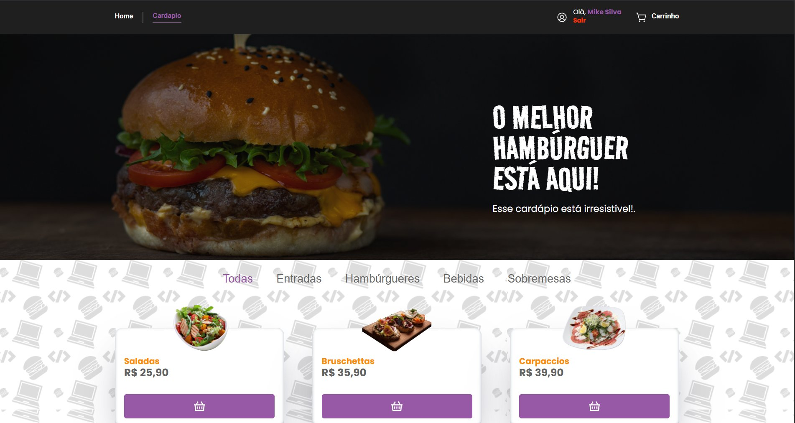
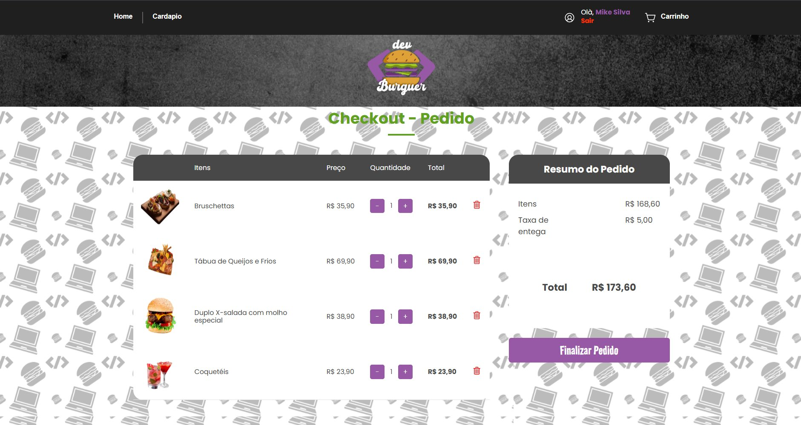
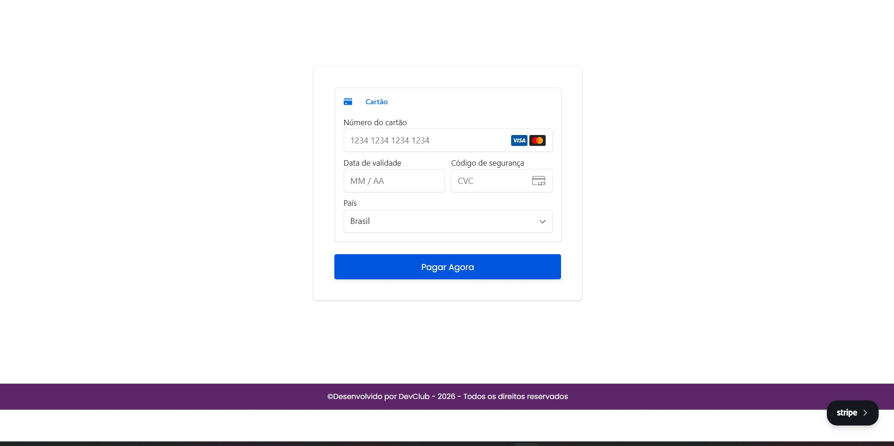
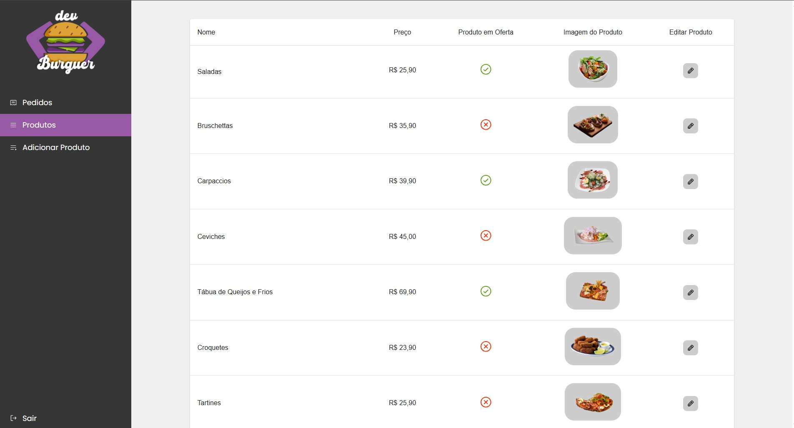

# Dev Burguer Interface

Interface web de uma hamburgueria, desenvolvida com React e Vite. O projeto reúne a experiência de compra do cliente — cardápio, carrinho e checkout — e telas administrativas para gerenciar produtos e acompanhar pedidos.

## Funcionalidades

- Página inicial com ofertas e acesso ao cardápio.
- Listagem de produtos e filtro por categoria.
- Carrinho de compras e resumo do pedido.
- Cadastro e login de usuários.
- Checkout com Stripe Elements.
- Área administrativa com listagem, criação e edição de produtos, além de consulta e filtro de pedidos por status.

## Capturas de tela

### Página inicial e cardápio



### Carrinho e resumo do pedido



### Pagamento com Stripe



### Administração de produtos



## Tecnologias

- React 19 e Vite 8
- React Router
- Axios
- Material UI e styled-components
- React Hook Form e Yup
- Stripe React

## Requisitos

- Node.js e Yarn instalados.
- A API de backend do projeto disponível em `http://localhost:3001`.
- Configuração válida do Stripe para testar o fluxo de pagamento.

> Este repositório contém somente a interface. As telas dependem de uma API externa para autenticação, categorias, produtos e pedidos. A URL da API está definida em `src/services/api.js`.

## Como executar

1. Clone o repositório e entre na pasta:

   ```bash
   git clone https://github.com/mikesilva32/Dev-Burguer-Interface.git
   cd Dev-Burguer-Interface
   ```

2. Instale as dependências:

   ```bash
   yarn install
   ```

3. Inicie a API de backend em `http://localhost:3001`.

4. Inicie a aplicação em modo de desenvolvimento:

   ```bash
   yarn dev
   ```

   O Vite exibirá no terminal o endereço local para abrir no navegador.

## Scripts disponíveis

| Comando | Descrição |
| --- | --- |
| `yarn dev` | Inicia o servidor de desenvolvimento do Vite. |
| `yarn build` | Gera a versão de produção na pasta `dist`. |
| `yarn preview` | Serve localmente a versão de produção. |
| `yarn lint` | Verifica o código com ESLint. |

## Rotas principais

| Caminho | Tela |
| --- | --- |
| `/` | Página inicial |
| `/cardapio` | Cardápio |
| `/carrinho` | Carrinho |
| `/checkout` | Checkout |
| `/login` | Login |
| `/cadastro` | Cadastro |
| `/admin/pedidos` | Pedidos (admin) |
| `/admin/produtos` | Produtos (admin) |
| `/admin/novo-produto` | Cadastro de produto (admin) |
| `/admin/editar-produto` | Edição de produto (admin) |

## Pagamentos

A interface utiliza Stripe Elements e consulta a configuração do Stripe em `src/config/stripeConfig.js`. Para habilitar pagamentos, configure uma chave pública de teste ou produção conforme o ambiente e mantenha qualquer chave secreta exclusivamente no backend.
